# Tactyqal Labs: homepage redesign and blog platform

[](https://github.com/Avan14/Tactyqal-Hire-a-thon/actions/workflows/ci.yml)

A submission for the Tactyqal Labs Full Stack Developer Intern hire-a-thon on Devuty.

| Brief | What this repo delivers |
|---|---|
| **Task 1: Homepage redesign** | A rebuilt homepage in Next.js 16, implemented from an animated Claude Design comp (GSAP and Lenis), responsive from 375px, with every section fed by the live site's real copy. |
| **Task 2: Blog backend** | A NestJS + PostgreSQL blog API that replaces the separate WordPress install: schema, full CRUD, search, filters, validation, auth for writes, tests, and an importer that migrates the existing posts with their URLs intact. |
| Optional demo frontend | Blog index, article pages and a small admin, all running on the new API. |
| Live demo / video | **Live site:** https://tactyqal-hire-a-thon1.vercel.app · **API docs:** https://tactyqal-hire-a-thon-rmfr.onrender.com/api/docs · Demo video: _link added on submission_. The free API host sleeps when idle, so the first request after a quiet spell can take up to a minute. Or run it locally in about five minutes with the [quick start](#quick-start). |

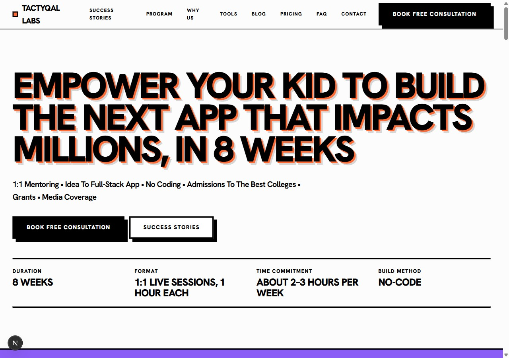

## What changed, and why

I started by auditing the current site before designing anything. The homepage sells trust to parents, but a few things undercut it:

- A newsletter popup covers the hero on first load, before a parent has read a word.
- The page has no `<title>` and no `<h1>`, and logs six console errors.
- The hero says "100+ students mentored" while a later section says "50+".
- The blog is a second system (WordPress) beside the CodeIgniter site: about 1,346 posts, 724 of them in "Uncategorized", plus a duplicate "Uncategorised" category.

So the redesign puts the parent's questions first and removes friction. The backend turns the blog from a separate CMS into a small, well-tested service that the site itself consumes.

| Before (live site) | After |
|---|---|
| 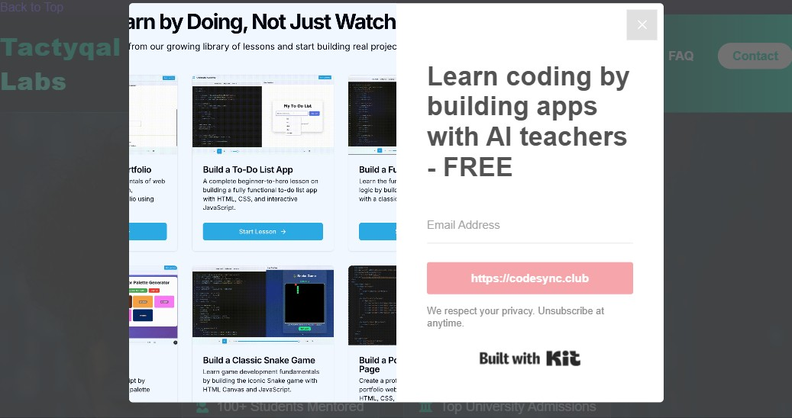 |  |

## Highlights

- **One system, end to end.** The homepage's "Learn from Industry Experts" section, the blog, the contact form and the newsletter form all run on the new API. Nothing on the page is a dead button.
- **Old URLs keep working.** The importer preserves every WordPress slug, so `/blog/{slug}/` links and their search ranking survive the migration.
- **The motion carries the story.** The hero pins and shrinks into a student-app postcard, and the 8-week program is a sideways track: one panel per stage, with what happens and which of Tactyqal's free tools supports it. An intro loader (once per browser session, skippable with a click or Escape), a lime custom cursor that labels booking buttons, and a light film grain complete the look. Visitors who prefer reduced motion get none of those, plus a still hero, no smooth scrolling and stacked panels. Touch devices get no cursor, and phones get the stacked panels.
- **Real content only.** All copy comes from tactyqal.com. Nothing is invented: no customers, quotes, numbers or logos. See [Content notes for the Tactyqal team](#content-notes-for-the-tactyqal-team).
- **Every state is designed.** Loading skeletons, empty results, API errors with a working retry, form field errors and success messages all use the comp's states.

## Screenshots

| | |
|---|---|
| 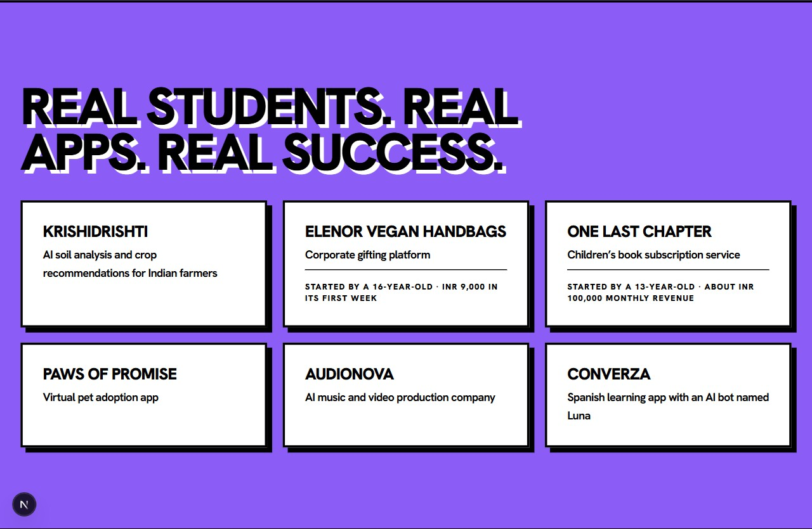 | 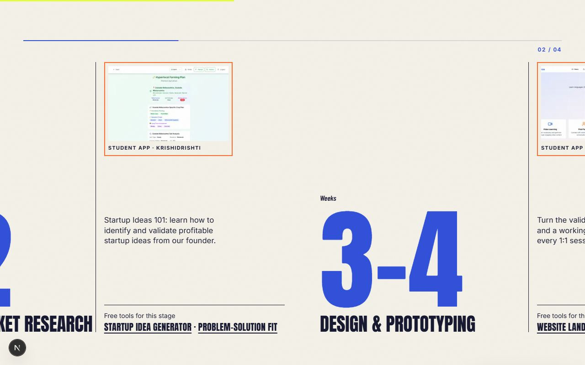 |
|  | 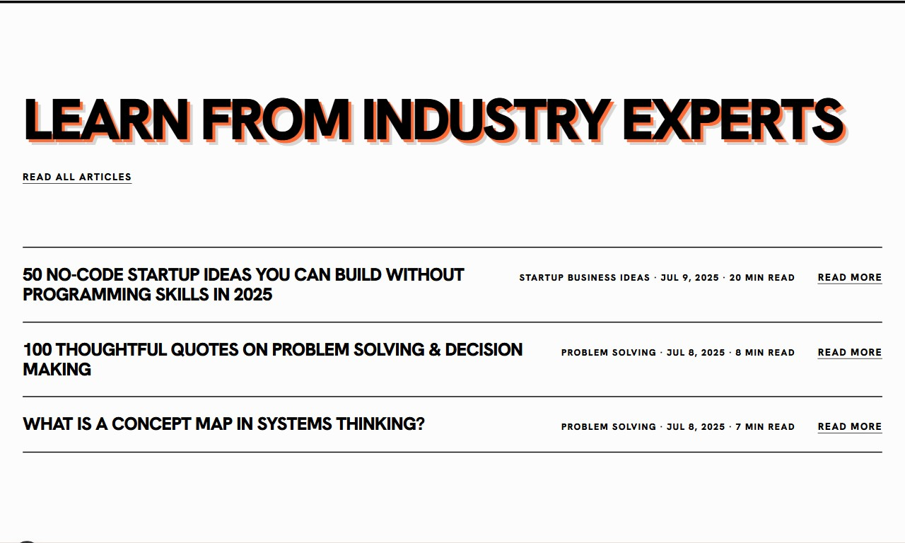 |
| 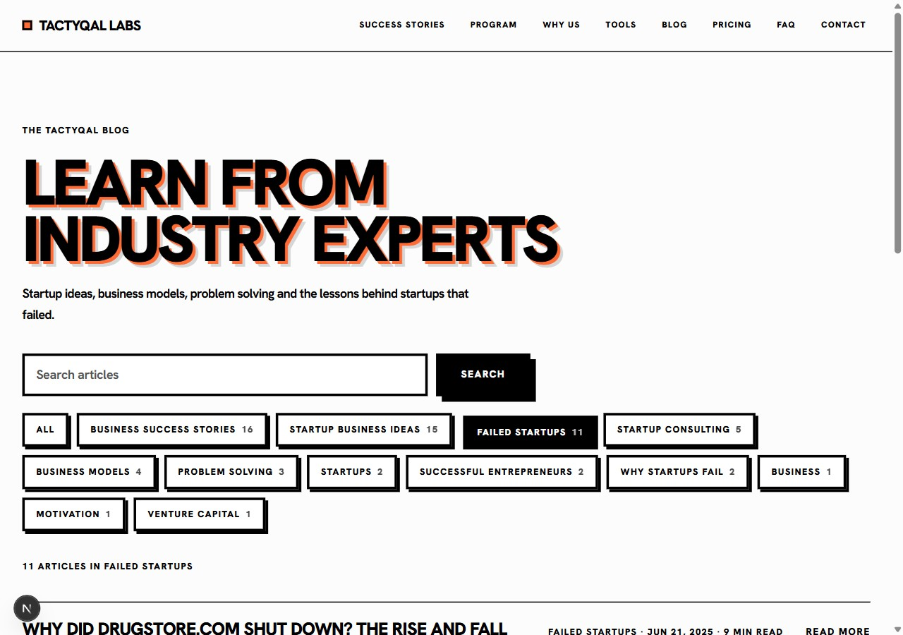 | 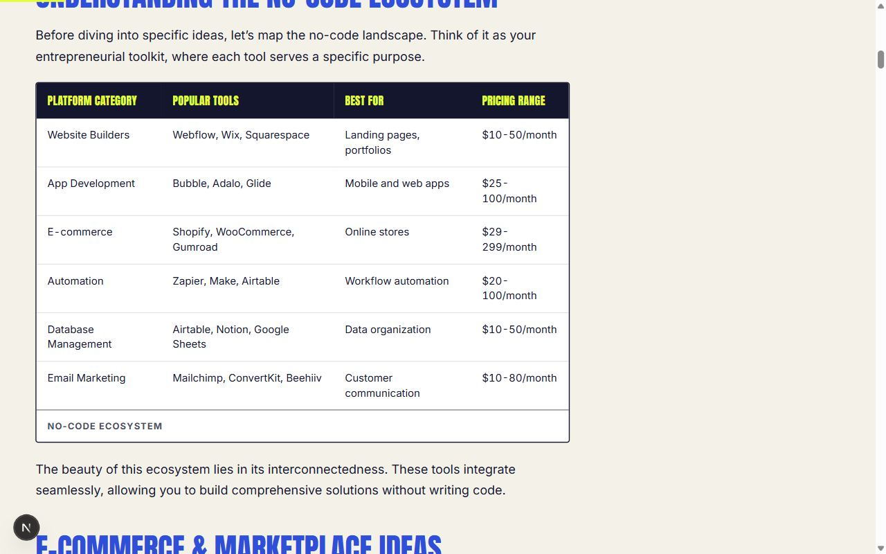 |
| 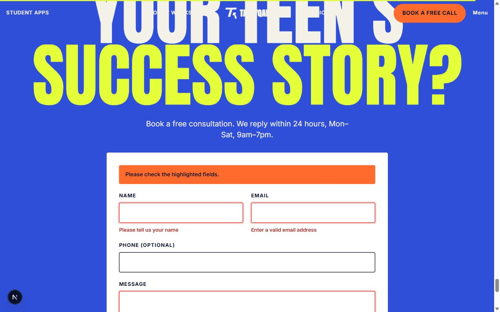 | 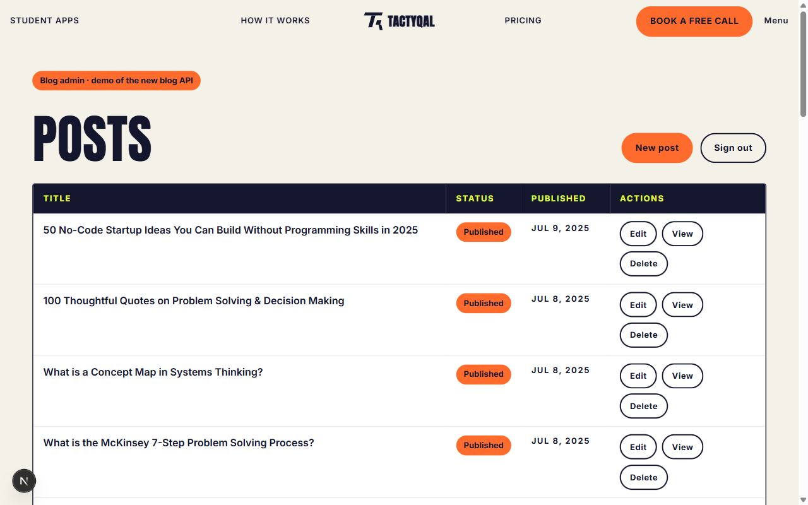 |


## Architecture

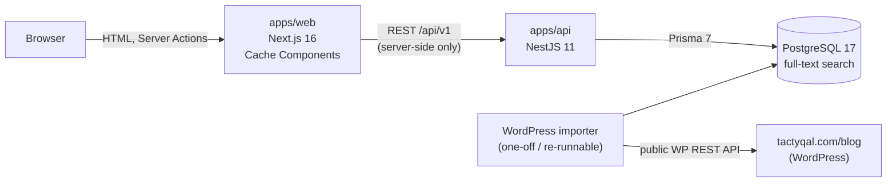

**Every API call comes from the web server, never the browser.** Pages read through cached server functions, and forms submit through Server Actions. The API URL and the admin token never reach client JavaScript, and the API needs no public CORS surface.

### Key decisions

| Decision | Why | Trade-off |
|---|---|---|
| **Separate NestJS API instead of Next.js route handlers** | Mirrors Tactyqal's real split (site plus blog) and gives the blog a clean, independently testable and deployable backend. | Two processes to run. Docker Compose and one `pnpm dev` keep that simple. |
| **PostgreSQL full-text search** with a weighted `tsvector` (title > excerpt > body) and a GIN index | Search is good enough for thousands of posts without running Elasticsearch or Algolia. | No typo tolerance. The column is maintained by a trigger, because Prisma misreads generated columns as defaults and would emit broken migrations. |
| **Sanitize HTML on write**, with an allow-list | Imported and admin-written content is stored clean, so readers never get unsafe markup. Tables, lists and YouTube embeds survive. YouTube is moved to the no-cookie domain. | Content written straight into the database bypasses it. All application write paths sanitize. |
| **Single admin bearer token** for writes | The brief asks for blog CRUD, not user management. The token is compared in constant time, and the web admin keeps it in an httpOnly cookie. | No per-author accounts or audit trail. That is the natural next step (see [Next steps](#next-steps)). |
| **Cache Components with tag invalidation** | Public pages are prerendered shells with cached data, tagged `posts`. Admin saves call `updateTag('posts')`, so readers see edits on the next request. | Edits made directly through the API, not the admin, show within the `minutes` cache lifetime. |
| **Public reads unthrottled, writes rate limited** | The web server reads for every visitor from one IP, so a per-IP read limit would throttle the whole site. Leads and subscribers are limited per visitor. The web server passes on the visitor's IP, which the API trusts only from loopback or from a caller holding the shared `INTERNAL_API_SECRET`. | Read abuse protection belongs at the edge (CDN or WAF) in production. |
| **NestJS 11, Prisma 7, TypeScript 5.9** rather than the very newest majors | NestJS 12 is ESM-only and Prisma 8 is still a release candidate. Both break the Jest toolchain today. | One major behind on Nest, deliberately. |

## Data model

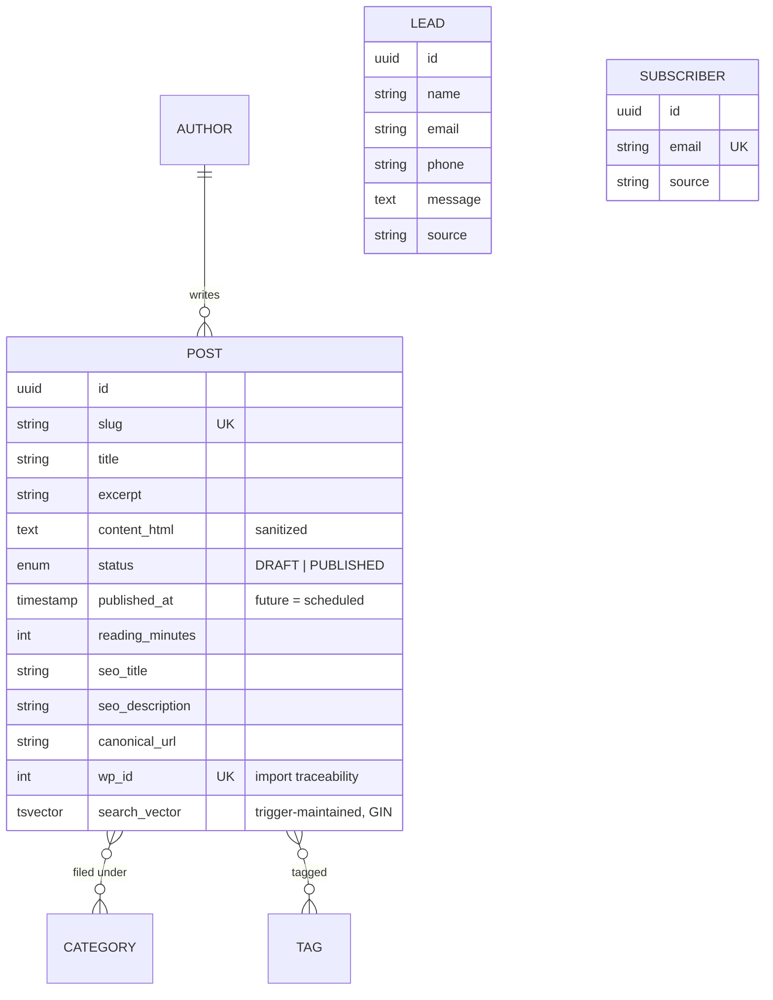

Indexes cover `slug`, `(status, published_at desc)`, `author_id` and the search vector. `wp_id` columns make the importer idempotent and keep each post traceable to its WordPress origin.

## API

Base URL: `/api/v1`. Interactive OpenAPI docs are served at `/api/docs`. Every error has the same shape:

```json
{ "error": { "code": "NOT_FOUND", "message": "No post found with slug \"x\"", "requestId": "…" } }
```

| Method | Path | Auth | Purpose |
|---|---|---|---|
| GET | `/posts` | public / admin | Paginated list. Filters: `category`, `tag`, `author`, `q` (full-text, ranked), `page`, `limit` (max 50). Admins may add `status`. |
| GET | `/posts/:slug` | public / admin | One post with its HTML body. Drafts and future-dated posts are visible to admins only. |
| POST | `/posts` | admin | Create. Slug, excerpt and reading time are derived when omitted. |
| PATCH | `/posts/:id` | admin | Partial update. Send `null` to clear an optional field. The slug never changes implicitly, so published URLs stay stable. |
| DELETE | `/posts/:id` | admin | Delete (204). |
| GET | `/categories`, `/tags`, `/authors` | public | Terms with published-post counts. |
| POST | `/leads` | public, rate limited | Consultation request from the homepage. Includes a honeypot. |
| POST | `/subscribers` | public, rate limited | Newsletter sign-up. Idempotent, and the same answer is returned for new and existing emails. |
| GET | `/health` | public | Liveness plus a database check. |

Validation rejects unknown fields and wrong types, and returns per-field `details`. Unknown category or author slugs are a 400 that names them. Duplicate slugs are a 409.

## Quick start

Requirements: Node 20+, pnpm 10, Docker.

```bash
pnpm install
docker compose up -d db                       # Postgres 17 on :5433 (dev + test databases)
cp apps/api/.env.example apps/api/.env        # then set ADMIN_API_TOKEN to a long random value
cp apps/web/.env.example apps/web/.env.local
pnpm db:migrate                               # apply migrations
pnpm import:wp                                # import the newest 60 posts from tactyqal.com/blog
pnpm dev                                      # API on :4000, site on :3000
```

- Site: http://localhost:3000
- Blog: http://localhost:3000/blog
- Admin: http://localhost:3000/admin (sign in with the `ADMIN_API_TOKEN` value)
- API docs: http://localhost:4000/api/docs

Importer options: `pnpm import:wp --limit 200` imports more posts, and `--dry-run` fetches and maps without writing. Re-running the importer refreshes existing posts instead of duplicating them.

## Testing

```bash
pnpm test                    # API unit + end-to-end suites
pnpm --filter web typecheck
pnpm lint
```

| Suite | What it covers |
|---|---|
| API unit (46 tests) | Slug generation and collisions, the HTML sanitizer (scripts, event handlers, `javascript:` links, iframe hosts, table and embed preservation), reading time, excerpts, entity decoding, the WordPress mapper (UTC dates, Yoast fields, category clean-up) and importer paging, the health check, and concurrent newsletter sign-ups. |
| API end-to-end (52 tests) | Every endpoint against a real Postgres test database, through the same HTTP pipeline as production: CRUD, clearing fields with `null`, pagination, filters, ranked search, draft visibility, 400/401/404/409/413 paths, long post bodies, malformed JSON, per-visitor rate limits, honeypot, idempotent subscriptions. |
| Manual browser pass | Homepage at 375px and 1280px, the contact form with field errors and success (row verified in the database), blog filters and search, a post with a table and a video, the admin create → public page → delete → 404 round trip, and console checks. |

The production build (`pnpm --filter web build`) partially prerenders every content route. It does not need the API to be running.

GitHub Actions runs all of this on every push and pull request ([`.github/workflows/ci.yml`](.github/workflows/ci.yml)). The end-to-end suite runs against a Postgres 17 service container, the same version as local development.

## Security notes

- The admin token is compared in constant time, sent only server to server, and stored in the browser as an httpOnly, `SameSite=Strict` cookie scoped to `/admin`.
- Post HTML is sanitized with an allow-list before storage. External links get `rel="noopener noreferrer"`, and only YouTube iframes survive.
- `helmet` headers, strict DTO validation, a CORS allow-list and rate limits on public writes are in place. Secrets come from the environment and are validated at boot.
- Rate limits key on the visitor's IP. When the web app and the API run on different hosts, set the same `INTERNAL_API_SECRET` in both. The API then trusts the `X-Client-IP` header only from a caller that presents it, so the limit cannot be dodged by inventing addresses.
- Server Actions get Next.js's built-in origin checks.

## Content notes for the Tactyqal team

These are things I deliberately did **not** decide for you:

1. **Conflicting student counts.** The live hero says 100+ students and the "Why" section says 50+. The redesign keeps 50+ in the "Proven Track Record" line, as written, and leaves the count out of the hero until you confirm the number.
2. **One editorial sentence.** The live site names the "Design & Prototyping" stage without describing it. The timeline uses one plain sentence there, marked `EDITORIAL` in `apps/web/content/site.ts`. Everything else is your copy, verbatim.
3. **Free tools link.** The tools on the live page have no links. "Access All Tools Free" points at your tools section until the tools have their own URL (a single setting in `site.ts`).
4. **Claims.** "Results guaranteed or money back" and "100% of our students launch a working app" are kept as your wording. You may want them backed by specifics.
5. **Comp sections left out.** The design comp had a founder card with photo and credentials, a university-names block, parent quotes, an instalment line and refund terms. The live site has no content for them, so they are not built. They are easy to add to `apps/web/content/site.ts` when you have real material. The student screenshots are illustrated placeholders for the same reason.

## Project structure

```
apps/
  api/        NestJS API: posts, taxonomy, leads, subscribers, health
    prisma/   schema and migrations (including the search trigger)
    scripts/  WordPress importer and its mapper (+ tests)
    test/     end-to-end suites
  web/        Next.js site: homepage, blog, admin
    content/  homepage copy (single source of truth)
    lib/      API client, cached data access, admin session
```

## Next steps

- Per-author accounts with roles and an edit history, replacing the single admin token.
- A rich-text editor in the admin, in place of the raw HTML field.
- Serve imported images from our own storage instead of linking to WordPress uploads.
- Redirect rules and a cut-over plan for moving `/blog` from WordPress to this service.
- Deploy: the web app to Vercel, and the API and Postgres to a managed host, with deploys gated on CI.
